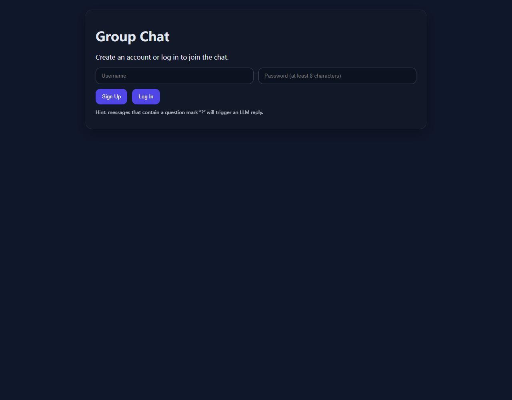
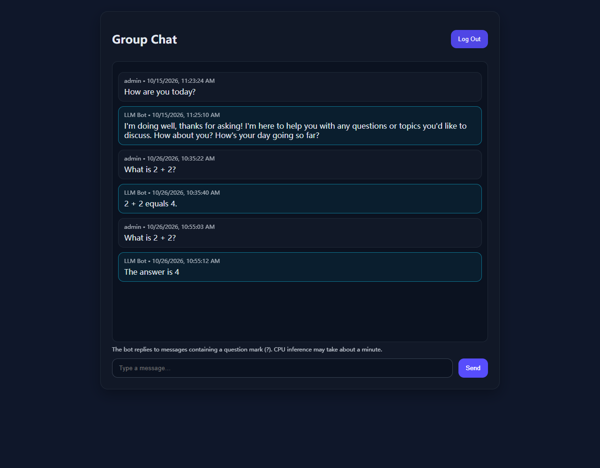
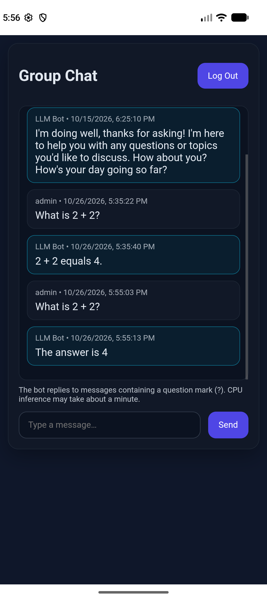
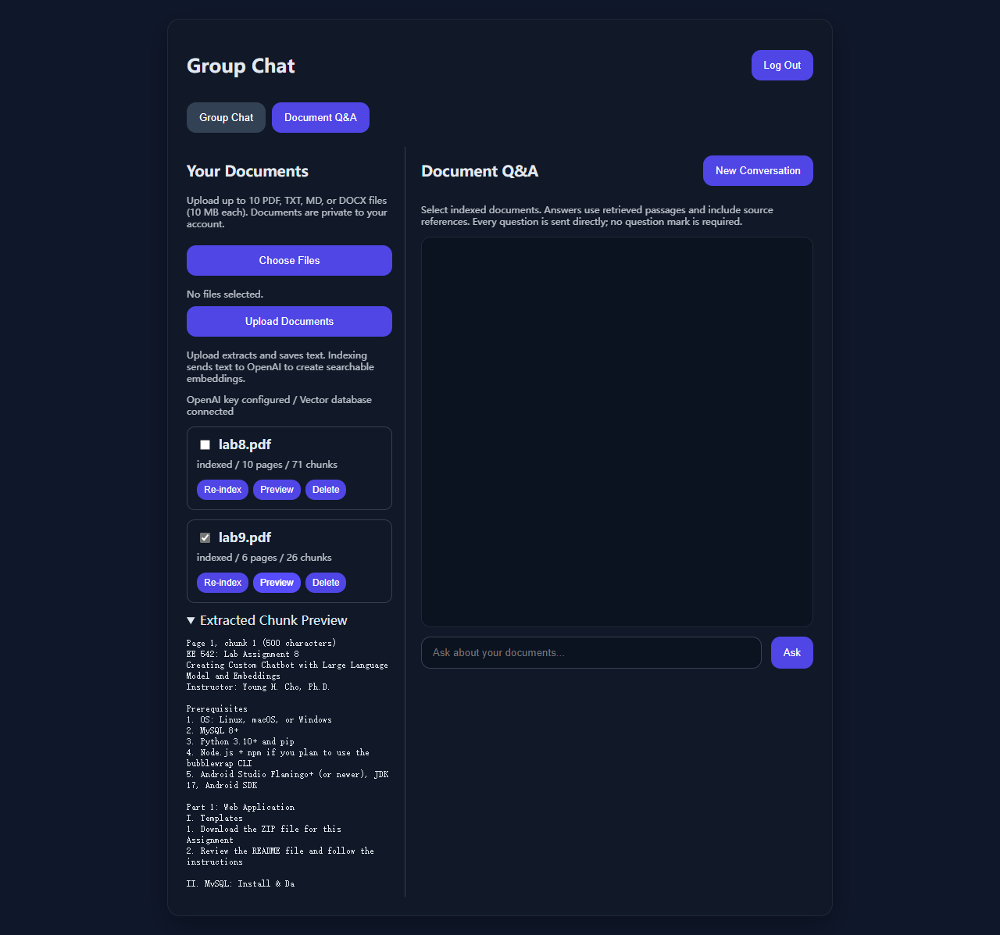
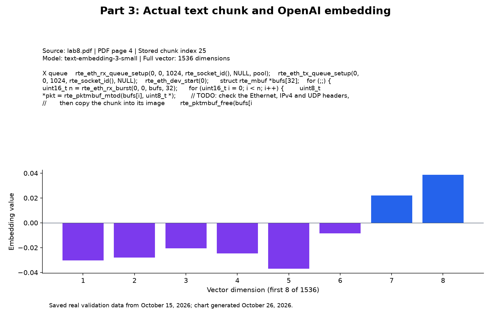
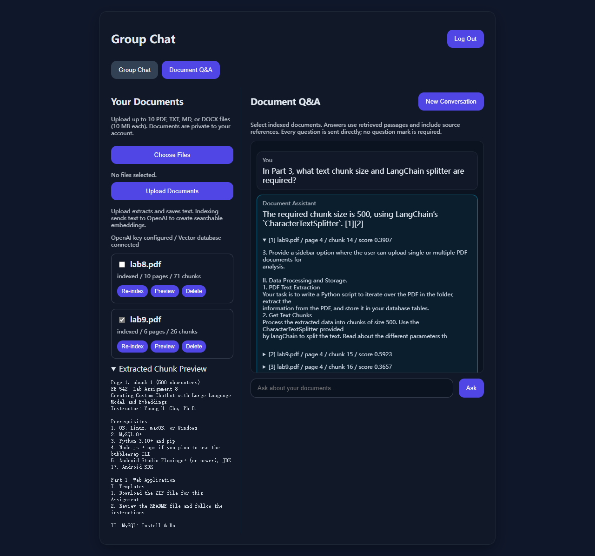
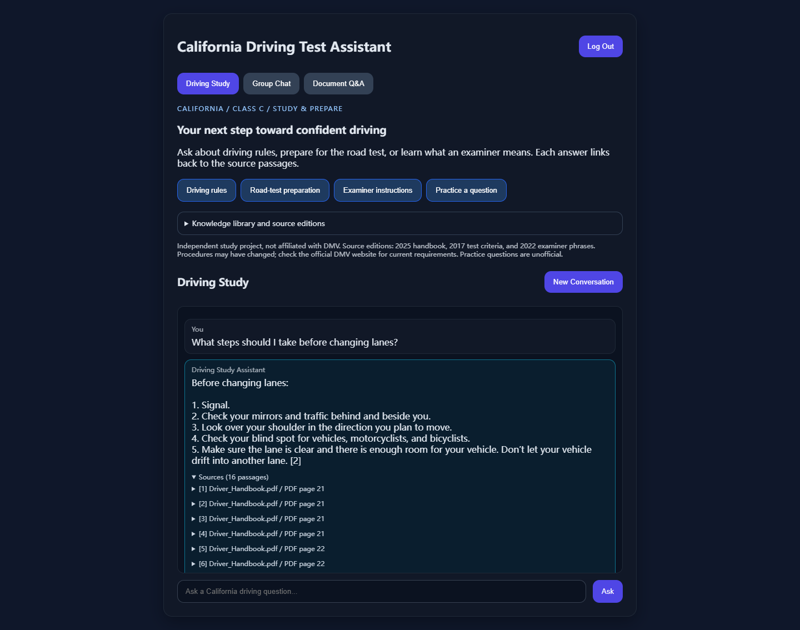

# EE 542 Lab Report

**Project:** California Driving Test Assistant  

The screenshots show the website and Android app in operation. Q&A examples contain real model answers, and the embedding figure visualizes actual text and vector values.

## Part 1: Web Application

This stage implemented a general-purpose group-chat website.

- **Database/security:** MySQL 8.4 stores accounts and messages in `groupchat` with utf8mb4. A dedicated database user, generated passwords, Argon2 hashes, and JWT authentication protect access. Secrets remain in the ignored `.env`.
- **Interfaces:** FastAPI serves HTML/CSS/JavaScript. REST handles registration, login, history, and message submission; WebSockets broadcast messages. History persists after reconnecting.
- **Model/server:** We selected llama.cpp, using **Llama 3.2 3B Instruct Q4_K_M** on CPU with a 4096-token context, replacing the PDF's larger examples. Its Docker endpoint is `http://llama:8001/v1`. Messages containing `?` trigger replies. The alternative vLLM option was not needed.
- **Result:** Authentication, invalid-input rejection, two-client broadcasts, persistence, and real inference passed. “What is 2 + 2?” returned **4**, with the reply saved and broadcast.

*Figure 1. Group Chat registration and login interface.*

*Figure 2. Group Chat interface with the local Llama reply: “The answer is 4.”*

## Part 2: Mobile Application Wrapper

Built and installed the Android TWA app **GroupChat**, package `com.helloworld.groupchat.twa`, wrapping the generic Part 1 website. It was later renamed **CA Driving Study** in Part 4. An HTTPS origin and [Digital Asset Links](groupchat_app_src/frontend/.well-known/assetlinks.json) associate the website with the matching package and signing-certificate SHA-256 fingerprint, enabling full TWA without a browser address bar.

**Result:** Android Studio emulator testing with Chrome verified registration/login, chatbot responses, and restored sessions/history after reopening. The older Android 8.1 phone lacked a compatible browser; full TWA acceptance therefore used the permitted emulator option.

Gradle build/lint passed. Additional app validation is recorded in [the Android evidence](groupchat_app_src/artifacts/reports/Android-docker-validation.json).

*Figure 3. GroupChat TWA without a browser address bar, showing a group-chat question and the Llama reply.*

**Limit:** The temporary Cloudflare hostname may change, requiring Android reconfiguration and rebuilding.

## Part 3: Content Embeddings and LLM

This stage added general document Q&A, tested with `lab8.pdf` and `lab9.pdf`.

1. **Collect:** A sidebar supports single/multiple PDF uploads plus TXT/MD/DOCX. The CLI processes a document folder. Extracted text, page provenance, and chunks are stored in MySQL.
2. **Chunk:** LangChain `CharacterTextSplitter` uses a **500-character maximum**, **100-character overlap**, and an empty separator. Overlap preserves boundary context; final chunks may be shorter.
3. **Embed/store:** OpenAI `text-embedding-3-small` creates **1536-dimensional** vectors stored in Docker Qdrant, filtered by document owner.
4. **Retrieve/answer:** Questions use the same embedding model. Cosine similarity retrieves matching chunks, with adjacent context expansion. A LangChain conversation chain uses **gpt-6-luna**, retrieved passages, and six recent turns. SQL-backed bounded memory implements the requested conversation-memory behavior. Answers cite sources and acknowledge insufficient evidence.
5. **Driver:** `rag_cli.py` repeatedly reads questions, prints answers/sources, and stops when the user types `exit`.

**Results:** `lab8.pdf` yielded 71 chunks from 10 pages; `lab9.pdf` yielded 26 from 6 pages. All **97 vectors** survived a Qdrant restart. Five real-API cases, browser checks, and the authenticated CLI passed. The system correctly answered **CharacterTextSplitter, 500 characters** and declined an unsupported question about the instructor's favorite ice-cream flavor.

**Actual embedding example:** A chunk from `lab8.pdf`, PDF page 4, contains `rte_eth_rx_burst(...)`; its vector begins `[-0.030346941, -0.028088849, -0.0205517, -0.024610166, ...]`. This previews 1536 dimensions. Full provenance and test results are in the [Part 3 evidence](groupchat_app_src/artifacts/reports/Part3-real-validation.json).

*Figure 4. Document Q&A interface with both lab PDFs indexed and extracted chunks visible.*

*Figure 5. Actual text chunk and the first eight of 1536 OpenAI embedding values.*

*Figure 6. Document Q&A answer about 500-character chunks and CharacterTextSplitter, with the retrieved PDF passage expanded.*

## Part 4: Custom Content Chatbot App

This stage introduced the driving topic, curated DMV collection, Driving Study interface, and Android branding, building on the generic components from Parts 1–3.

**Topic/audience:** California Class C driving-test preparation for new drivers, including learners studying English examiner instructions. Official DMV sources provide focused coverage of rules, road-test preparation, and vocabulary.

| Source | Edition | Pages | Chunks |
|---|---|---:|---:|
| California Driver's Handbook | June 2025 | 92 | 373 |
| Driving Test Criteria | October 2017 | 40 | 104 |
| Words and Phrases for Class C Driving Tests | March 2022 | 2 | 6 |
| **Total** | | **134** | **483** |

The shared `ee542_driving` library powers Driving Study on the website and Android app. Features include suggested questions, citations, source passages, edition notices, unofficial practice, and private conversations. Cross-page checklist retrieval improves safety-check answers.

**Results:** [Eight cases passed](groupchat_app_src/artifacts/reports/Part4-real-validation.json), covering rules, safety checks, vocabulary, unknown facts, practice, version limits, new-user access, and unrelated-topic rejection. A lane-change answer explained signaling, mirrors/traffic, blind spots, and available space with citations. [Web/mobile and emulator checks](groupchat_app_src/artifacts/reports/Part4-ui-validation.json) verified answers and restored history.

**Limits:** The historical editions, especially the 2017 criteria, cannot establish current requirements. Users are directed to DMV for updates. Practice is unofficial; image-only content is not indexed.

*Figure 7. Driving Study answer about changing lanes, using OpenAI embedding retrieval and citing 16 source passages.*

## Part 5: Custom Word-Cluster Histogram Embeddings

### Implementation

The embedding pipeline reused 483 DMV text chunks. Word2Vec was configured
to learn 100-dimensional word vectors using the Skip-gram architecture.

Custom K-means groups the vocabulary vectors into K clusters. Each
iteration assigns vectors to their nearest centroid and updates each
centroid by averaging its assigned vectors.

For each chunk, the encoder counts the tokens assigned to each cluster.
The K-dimensional count vector is divided by the total number of tokens
in the chunk:

h_j(d) = count of tokens assigned to cluster j / total tokens in d

Thus, the word-vector dimension N=100 is different from the final
chunk-vector dimension K. We tested K=32 and K=64.

Queries use the same saved Word2Vec model and cluster mapping as the
documents. Unknown query tokens do not contribute to cluster counts.
Because normalization uses the total token count, a query histogram can
sum to less than one when it contains unknown tokens.

The main implementation files are:

| File | Purpose |
| --- | --- |
| word_histogram.py | Word2Vec training, custom K-means, histogram encoding |
| build_word_histogram.py | Build and save embeddings from the existing chunks |
| query_word_histogram.py | Query encoding, IDF weighting, similarity ranking |
| evaluate_word_histogram.py | Run the comparison experiments |
| rag_service.py and driving.py | Integrate custom retrieval into the existing RAG pipeline |
| app.py | Expose the active retrieval method through the health endpoint |

### Improvements and Experimental Setup

We compared three configurations on the same 12 questions:

| Configuration | Description |
| --- | --- |
| k32_plain | Normalized histogram with 32 word clusters |
| k64_plain | Normalized histogram with 64 word clusters |
| k64_idf | 64-cluster histogram with cluster-level IDF weighting |

Increasing K tests whether a finer grouping of words improves retrieval.
Cluster-level IDF gives relatively greater weight to clusters occurring
in fewer chunks. The same IDF weights are applied to document and query
vectors before cosine-similarity ranking.

Each configuration retrieves the top four chunks for each question,
producing 36 retrieval runs. Retrieved text, document metadata, scores,
and query details are saved for inspection.

### Observed Retrieval Results

The following cases were checked against retrieval_results.json.
Page numbers refer to the page metadata stored with the chunks.

| Question | K=32 | K=64 | K=64 + IDF |
| --- | --- | --- | --- |
| Driving in fog | No direct fog guidance in Top-4 | No direct fog guidance in Top-4 | Direct fog guidance at rank 4, Driver_Handbook.pdf, page 70 |
| School bus flashing red lights | Related school-bus content, but no explicit red-light rule in Top-4 | No direct school-bus red-light rule in Top-4 | Explicit rule at rank 4, Driver_Handbook.pdf, page 57 |
| Parking uphill beside a curb | Correct wheel-direction guidance at rank 1 | Correct guidance at rank 3 | Correct guidance at rank 1 |

These examples show that IDF can recover useful evidence missed by the
unweighted 64-cluster representation. Increasing K alone does not
consistently improve ranking: the uphill-parking result moved from
rank 1 with K=32 to rank 3 with K=64.

This is a small, qualitative retrieval comparison rather than a
measurement of final-answer accuracy. It does not establish that the
custom embeddings outperform OpenAI embeddings.

### Integration into the RAG System

The driving chatbot uses the word2vec_k64_idf retriever. It encodes the
question, applies IDF weights, and ranks chunk vectors using cosine
similarity to select four initial chunks.

The existing pipeline then expands the retrieved context and supplies
it to the language model for answer generation. Therefore, the final
source list can contain more than four passages. Retrieval comparisons
use the original Top-4 results before context expansion.

For the website fog-driving demonstration, the backend reported:

- method=word2vec_k64_idf
- chunks=483
- dimension=64
- known_words=8/8
- POST /api/driving/ask returned 200 OK

The website displayed an answer with citations and 17 source passages
after context expansion.

### Website and Android Validation

The website was tested against the modified backend. The health endpoint
reported status=ok, database=ok, and
driving_retrieval_method=word2vec_k64_idf.

For mobile validation, a temporary HTTPS tunnel forwarded requests to
the local Docker backend. The Android wrapper's launch URL and website
association string were updated to the new origin.

The application was built and run on a physical vivo X200s. Mobile
question answering was successfully tested against this backend.
The embeddings and language-model requests remain on the backend;
the Android application provides the mobile interface.
